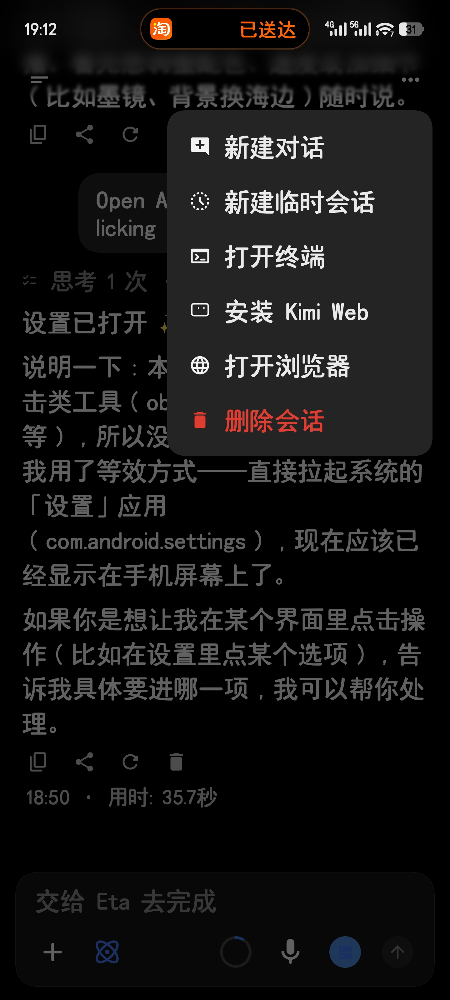
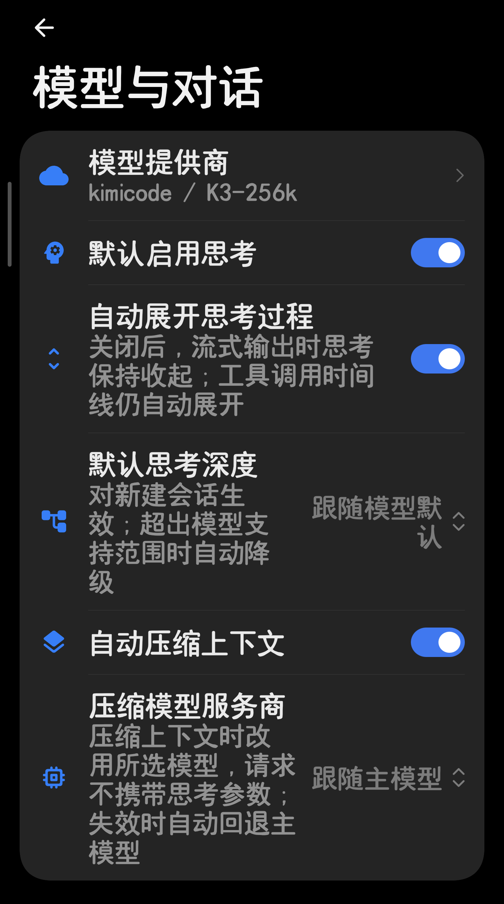
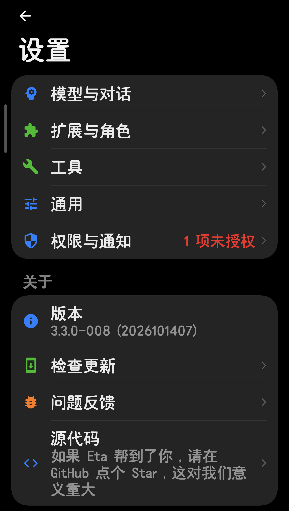

# Eta Mod

**简体中文** | [English](README_EN.md)

[Mangi-11/Eta](https://github.com/Mangi-11/Eta) 的个人修改版，与官方版**共存安装**互不影响（applicationId `io.github.mangi.eta.mod`，应用名「Eta Mod」，独立签名）。

   

**[下载 APK](https://github.com/Number444/Eta/releases)** · App 内「设置 → 检查更新」检测本仓库 Release；发现新版且仅有一个 APK 附件时，直接通过默认浏览器下载。

**版本号规则**：`官方版本号-三位 Mod 修订号`，如 `3.3.0-008`——左段跟随上游官方版本，右段为本 Mod 的迭代号；跟随上游升级后右段归零重排。

## Mod 特性

相对官方版的主要改动：

1. **超级岛运行控制**：任务状态实时上岛；GUI 运行期间暂停/继续、补充、停止三个控制键直接渲染在岛上，悬浮胶囊保持纯展示，不吞掉 Agent 对下层应用的点击。「补充」通过悬浮窗输入，提交后按官方插话语义取消当前任务并发送新消息；GUI 前台操控时岛文案显示「接管中」。
2. **液态玻璃界面**：主页、侧边栏与设置页采用统一的玻璃材质 Token、采样源和弹层架构，支持无模糊、默认模糊、液态玻璃三档及深浅色。
3. **思考与压缩控制**：自动展开思考开关、默认思考深度、独立压缩模型，并按厂商协议处理压缩请求的思考参数。
4. **厂商余额显示**：API Key 厂商可配置余额 API 地址与 JSON 路径，余额显示在模型选择弹窗厂商名右侧。
5. **会话管理与计时**：更多菜单提供删除会话和新建临时会话；临时会话退出或切换即销毁且不落库。每条回复显示完成时间与用时。
6. **分享成图重写**：按新 markdown 渲染层生成分享图片，表格/代码块正常成图，分享按钮带触感与成功/失败指示。
7. **配置兼容**：保留既有数据库和 Mod 设置升级路径；旧 DeepSeek 搜索配置自动迁移到官方加密存储，原 Exa 搜索已随官方搜索架构统一而移除。

当前上游基线为 **v3.3.3**，已并入 Codex/Grok 订阅登录、附件消息队列与插话、屏幕常亮、Gemini/MiniMax 语音、可配置网页搜索与读取，以及 ARM64 减包等官方能力。

## 界面预览（Mod 实拍）

| 更多菜单：临时会话 / 删除会话 | 临时会话（输入区标识条） |
| :-------------------------------------------: | :----------------------: |
|  |  |

| 模型与对话（Mod 设置区） | 设置主页 |
| :----------------------: | :------: |
|  |  |

## 上游能力

Eta 本体是面向 Android 的系统级 AI Agent：GUI 跨应用操作、终端（Android user/root Shell、Alpine / Debian Linux）、内置浏览器、文件工具、Skills 与 MCP 扩展、个人上下文检索、长期记忆、角色卡，以及通过 Xposed 接管电源键 / 小布 / 超级小爱的系统助手入口。可自备模型 API Key（BYOK），也可登录 Codex（ChatGPT）或 Grok 订阅账号；内置多家提供商配置并支持自定义服务。

完整功能介绍、使用文档与设计理念见上游仓库 [Mangi-11/Eta](https://github.com/Mangi-11/Eta) 及其 [README](https://github.com/Mangi-11/Eta/blob/main/README.md)。

| GUI Agent | 小布助手 BYOK（上游演示） |
| :-------: | :----------------------: |
|  |  |

## 本仓库文档

- [岛-通知机制调研](docs/ISLAND-EXPANSION-INVESTIGATION.md)：小米超级岛 / LiveUpdate 映射的完整测定结论（本 Mod 岛功能的实现依据）。
- [当前待办](TODO-MOD.md)：进行中、未开工与暂缓事项；完成记录见 git 历史与专题文档。
- 上游文档：[Agent Runtime](docs/AGENT_RUNTIME.md) · [技术实现](docs/TECHNICAL.md) · [设备支持与权限边界](docs/ROOTLESS_SUPPORT.md) · [HyperOS 系统入口](docs/HYPEROS_SYSTEM_ENTRY.md) · [终端原生组件](docs/TERMINAL_NATIVE.md)

## 致谢与许可证

- 上游作者 [Mangi-11](https://github.com/Mangi-11) 及 Eta 的所有参考项目（见上游 README）。
- 本仓库沿用上游 [PolyForm Noncommercial License 1.0.0](LICENSE)：未经上游作者书面授权，禁止二次分发、贩卖、收费代装及其他商业使用。
